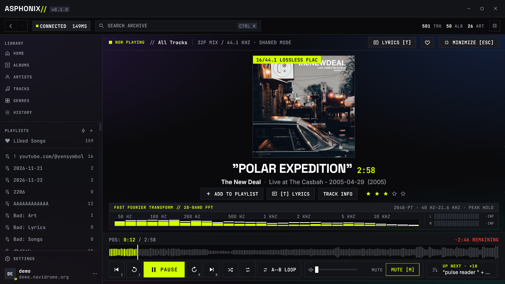

<div align="center">

# ASPHONIX//

**The player for audio enthusiasts.**<br>
A native desktop client for your Navidrome / Subsonic library: bit-perfect on Windows, light on resources,
and ready for AI agents to browse and play your music.

[](https://github.com/aspherex/asphonix/actions/workflows/build.yml)
[](https://github.com/aspherex/asphonix/releases)
[](LICENSE)


<picture>
  <source media="(prefers-color-scheme: light)" srcset="docs/screenshots/now-playing-light.png">
  
</picture>

</div>

ASPHONIX streams your library from a [Navidrome](https://www.navidrome.org/) (or other Subsonic / OpenSubsonic)
server and plays it through a native UI: a dark "audio terminal" with real readouts instead of decoration.
Every number on screen is either measured by the app or reported by your server.

<p align="center">
  
</p>

## Philosophy

ASPHONIX is built for people who care about *what actually reaches their ears*, and who want their tools to
stay out of the way.

1. **The signal path is sacred.** The original file is streamed from your server, decoded in Rust and, in
   exclusive mode, handed to your DAC at its native sample rate. No resampling, no hidden mixer, no
   "enhancement". Volume and ReplayGain are the only things that change samples, and only when you ask for them:
   at unity gain, playback is bit-perfect.
2. **Honesty over decoration.** No fake meters, no invented quality badges. Sample rate, bit depth, format and
   output mode are shown as they really are, including when exclusive mode is not available and the app falls
   back to shared mode. If a number can't be measured, it isn't shown.
3. **A player, not a platform.** Your library belongs to your server. ASPHONIX keeps a fast local index of it,
   talks to nothing else unless you turn it on, and collects no telemetry.
4. **Native or nothing.** No browser engine pretending to be an app. A small Rust binary with a hard memory and
   startup budget, refresh-rate animation, and near-zero CPU while it sits in the background.
5. **Keyboard first, mouse welcome.** Everything you do often has a key; everything else is one click away.
6. **Open to agents, on your terms.** Your library is data you should be able to ask questions about. ASPHONIX
   exposes it to AI agents over the Model Context Protocol, locally and off by default; letting an agent
   control playback is a separate, explicit switch.

## Why ASPHONIX

- **An honest signal path.** On Windows, files play bit-perfect through WASAPI exclusive mode at their native
  sample rate, gapless. The header always tells you what is really happening (format, sample rate, exclusive or
  shared mode), and a fallback to shared mode is shown as such, never hidden.
- **Native and lean.** No browser engine: a Rust + [GPUI](https://www.gpui.rs/) UI with hard budgets
  (<= 40 MB private working set in normal use, a few MB when minimized, ~300 ms to a visible window,
  refresh-rate scrolling). See [docs/PERF.md](docs/PERF.md) for the budgets and how they are measured.
- **Instant library.** A local SQLite (FTS5) mirror of your server makes browsing, sorting and search instant,
  even for libraries with tens of thousands of tracks.
- **Agentic interaction.** A built-in [MCP](https://modelcontextprotocol.io/) bridge lets Claude Code or any
  MCP client work with your library: "what did I play most this month?", "queue something like this album",
  "build a 40-minute focus set". Read access and playback control are separate opt-ins.
- **Your music, your machine.** No telemetry, no accounts, no network traffic beyond your own server
  (and nothing else unless you turn it on: scrobbling, update checks).

## Features

- **Playback:** gapless, WASAPI exclusive / shared output, ReplayGain (optional), A-B loop, +-10 s skips,
  session resume, optional play-queue sync with the server.
- **Library:** Home, Albums, Artists, Tracks, Genres, History, playlists, Liked Songs, ratings and stars,
  local smart playlists with a rule editor, full-text search across everything.
- **Now Playing:** waveform seek bar, 28-band FFT spectrum, peak meters, synced lyrics.
- **Queue:** rolling queue window, drag-and-drop reordering, shuffle with artist spread, **Flow** ordering
  (by tempo, key and genre where your tags provide them), autoplay / radio when the queue ends.
- **Desktop:** Windows media controls and media keys, scrobbling to your server, light and dark theme,
  multiple server profiles, keyboard-first (`Space`, `J`/`K`, `Ctrl+K`, `N`, `L`, ...).
- **MCP bridge (opt-in):** lets Claude Code or any MCP client browse your library and, only if you allow it,
  control playback. See [MCP bridge](#mcp-bridge).

<table>
  <tr>
    <td><a href="docs/screenshots/home.png"></a></td>
    <td><a href="docs/screenshots/albums.png"></a></td>
  </tr>
  <tr>
    <td><a href="docs/screenshots/tracks.png"></a></td>
    <td><a href="docs/screenshots/search.png"></a></td>
  </tr>
</table>

<sub>Screenshots use the public <a href="https://demo.navidrome.org">Navidrome demo</a> library; its playlists
are created by other demo visitors.</sub>

## Servers

- **Tested:** Navidrome 0.6x.
- **Should work** (Subsonic API 1.16.1 / OpenSubsonic): Gonic, LMS, Ampache, Airsonic-Advanced and others.
  Features such as synced lyrics depend on what the server supports. Reports from other servers are welcome.

## Platforms

| | Windows 10/11 | macOS (Apple Silicon) | Linux (x64) |
|---|---|---|---|
| Status | primary | newer, less tested | newer, less tested |
| Output | WASAPI exclusive (bit-perfect) or shared | shared (CoreAudio via cpal) | shared (ALSA via cpal) |
| Media keys / OS now-playing | yes (SMTC) | – | – |
| Password storage | Credential Manager | Keychain | Secret Service (GNOME Keyring, KWallet) |

GPUI has no accessibility support yet, so screen readers see an unlabeled window
(see [docs/GPUI-GAPS.md](docs/GPUI-GAPS.md)).

## Install

Download the archive for your platform from [Releases](https://github.com/aspherex/asphonix/releases).
The builds are not code-signed yet:

- **Windows:** unzip and run `asphonix.exe`. SmartScreen may warn on first start ("More info" > "Run anyway").
- **macOS:** open the `.dmg` and drag `ASPHONIX.app` to Applications. Gatekeeper blocks the first start:
  right-click > Open, or `xattr -dr com.apple.quarantine /Applications/ASPHONIX.app`.
- **Linux:** unpack the `.tar.gz` and run `./asphonix`. Needs a Secret Service provider (GNOME Keyring or KWallet)
  to remember your password.

On first start, enter your server URL, user name and password. The password goes into the OS keychain, never
into a file; settings, the session and the library database live in the platform config/data directories
(`%APPDATA%\dev.asphonix.app` and `%LOCALAPPDATA%\dev.asphonix.app` on Windows).

## Build from source

Requirements: a recent stable Rust toolchain (edition 2024), plus

- **Windows:** the MSVC build tools.
- **macOS:** Xcode (the full install: GPUI compiles its Metal shaders at build time).
- **Linux** (Debian/Ubuntu names): `pkg-config libasound2-dev libdbus-1-dev libfontconfig1-dev libfreetype6-dev
  libwayland-dev libxkbcommon-dev libxkbcommon-x11-dev libx11-xcb-dev libxcb1-dev libvulkan-dev libzstd-dev`.

```sh
cargo run -p asphonix-ui --release      # or: cargo build --release  ->  target/release/asphonix(.exe)
cargo test
cargo clippy --all-targets -- -D warnings
```

`cargo build --release` also builds `asphonix-mcp`; keep it next to `asphonix` for the MCP bridge.

## MCP bridge (agentic interaction)

ASPHONIX ships `asphonix-mcp`, a [Model Context Protocol](https://modelcontextprotocol.io/) server that connects
an AI agent to the running player:

| Access | Tools |
|---|---|
| Read (on when the bridge is enabled) | `search`, `get_tracks`, `get_album`, `get_artist`, `list_genres`, `list_playlists`, `get_playlist`, `list_smart_playlists`, `get_smart_playlist_tracks`, `library_stats`, `now_playing`, `get_queue`, `listening_history`, `listen_events`, `top_artists`, `top_tracks`, `skip_stats` |
| Control (separate opt-in) | `play_tracks`, `play_source`, `enqueue`, `play_pause`, `next`, `previous`, `seek`, `set_volume_db` |

Off by default. Enable it in **Settings > Claude (MCP)**; the page shows the exact command to register it:

```sh
claude mcp add asphonix -- "C:\path\to\asphonix-mcp.exe"
```

The bridge only listens locally (a named pipe on Windows, a Unix socket elsewhere), proves its identity to the
client and requires a per-session token. Read tools (library, queue, history) work as soon as it is enabled;
playback control is a separate switch.

## FAQ

**The header says SHARED MODE. Why not exclusive?** Exclusive mode is Windows-only (check Settings > Output)
and needs a device that accepts the file's sample rate and bit depth, and no other app holding it exclusively.
If the device refuses, ASPHONIX falls back to shared mode and says so.

**Does it work with Jellyfin or Plex?** No. ASPHONIX speaks the Subsonic / OpenSubsonic API only.

**Where are the logs?** Crashes are written to `logs/crash.log` in the data directory
(`%LOCALAPPDATA%\dev.asphonix.app` on Windows). For a detailed trace, start ASPHONIX with `ASPHONIX_LOG=<file>`.

**Does ASPHONIX phone home?** No. Update checks are off unless a release channel is configured and you enable
them (see [docs/UPDATES.md](docs/UPDATES.md)).

## Contributing

Bug reports, server compatibility reports and pull requests are welcome. Please read
[CONTRIBUTING.md](CONTRIBUTING.md) and the [Code of Conduct](CODE_OF_CONDUCT.md); security issues go through
[SECURITY.md](SECURITY.md), not public issues.

```
crates/asphonix-api    the Backend trait the UI talks to (types, commands, events)
crates/asphonix-core   Subsonic client, library DB + sync, audio engine, scrobbling, session, MCP bridge, updater
crates/asphonix-real   Backend implementation on top of asphonix-core (+ cover-art cache)
crates/asphonix-ui     the GPUI app, binary `asphonix`
crates/asphonix-mcp    MCP stdio server `asphonix-mcp` that connects to a running ASPHONIX
```

## License

MIT, see [LICENSE](LICENSE). The bundled fonts (Inter, JetBrains Mono, Space Grotesk) are under the SIL Open
Font License 1.1, see `assets/fonts/OFL-*.txt`.

Built on [GPUI](https://www.gpui.rs/) (Zed Industries), [Symphonia](https://github.com/pdeljanov/Symphonia),
[rusqlite](https://github.com/rusqlite/rusqlite) and the [OpenSubsonic](https://opensubsonic.netlify.app/) API.
