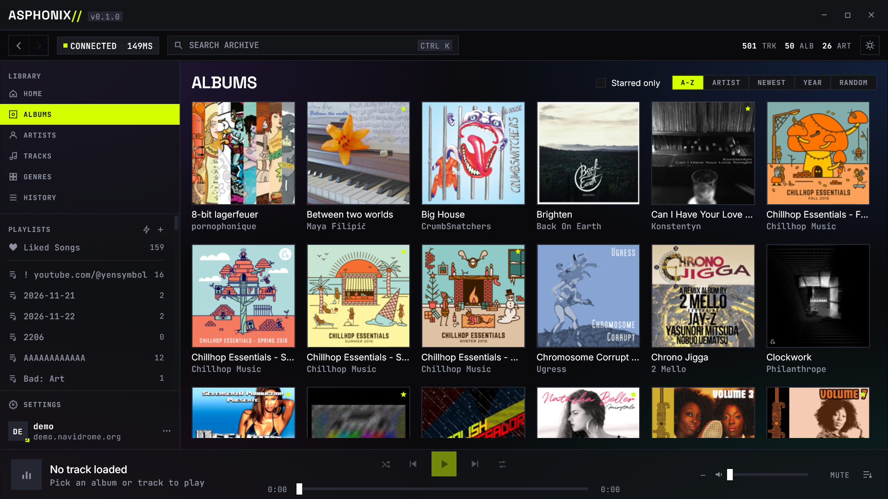

<div align="center">


# ASPHONIX//

### The player for audio enthusiasts.

A native desktop client for your **Navidrome / Subsonic** library.<br>
Bit-perfect on Windows · light on resources · ready for AI agents.

[](https://github.com/aspherex/asphonix/actions/workflows/build.yml)
[](https://github.com/aspherex/asphonix/releases)
[](LICENSE)


[**Philosophy**](#-philosophy) ·
[**Features**](#-features) ·
[**Install**](#-install) ·
[**Agents (MCP)**](#-agentic-interaction-mcp) ·
[**Shortcuts**](#-keyboard) ·
[**FAQ**](#-faq)

</div>

---

ASPHONIX streams your library from a [Navidrome](https://www.navidrome.org/) (or any Subsonic / OpenSubsonic)
server and plays it through a native UI: a dark *audio terminal* with real readouts instead of decoration.
Every number on screen is either measured by the app or reported by your server.

<picture>
  <source media="(prefers-color-scheme: light)" srcset="docs/screenshots/now-playing-light.png">
  
</picture>

<table>
  <tr>
    <td width="33%" valign="top">
      <h4>🎚️ Honest signal path</h4>
      Bit-perfect WASAPI exclusive output at the file's native sample rate, gapless. The header always shows
      what is really playing, including a fallback to shared mode.
    </td>
    <td width="33%" valign="top">
      <h4>⚡ Native and lean</h4>
      Rust + GPUI, no browser engine. Hard budgets: ≤ 40 MB of RAM in normal use, ~300 ms to a window, a few MB
      and near-zero CPU when minimized.
    </td>
    <td width="33%" valign="top">
      <h4>🤖 Ready for agents</h4>
      A built-in MCP bridge lets Claude Code and other agents explore your library and, if you allow it,
      run the queue.
    </td>
  </tr>
</table>

## // Philosophy

ASPHONIX is built for people who care about *what actually reaches their ears*, and who want their tools to
stay out of the way.

1. **The signal path is sacred.** The original file is streamed from your server, decoded in Rust and, in
   exclusive mode, handed to your DAC at its native sample rate. No resampling, no hidden mixer, no
   "enhancement". Volume and ReplayGain are the only things that change samples, and only when you ask for
   them: at unity gain, playback is bit-perfect.
2. **Honesty over decoration.** No fake meters, no invented quality badges. Sample rate, bit depth, format and
   output mode are shown as they really are, including when exclusive mode is not available and the app falls
   back to shared mode. If a number can't be measured, it isn't shown.
3. **A player, not a platform.** Your library belongs to your server. ASPHONIX keeps a fast local index of it,
   talks to nothing else unless you turn it on, and collects no telemetry.
4. **Native or nothing.** No browser engine pretending to be an app. A small Rust binary with a hard memory
   and startup budget, refresh-rate animation, and near-zero CPU while it sits in the background.
5. **Keyboard first, mouse welcome.** Everything you do often has a key; everything else is one click away.
6. **Open to agents, on your terms.** Your library is data you should be able to ask questions about.
   ASPHONIX exposes it to AI agents over the Model Context Protocol, locally and off by default; letting an
   agent control playback is a separate, explicit switch.

## // Features

| | |
|---|---|
| **Playback** | Gapless · WASAPI exclusive or shared output · optional ReplayGain · A-B loop · ±10 s skips · session resume · optional play-queue sync with the server |
| **Library** | Home, Albums, Artists, Tracks, Genres, History · playlists and Liked Songs · ratings and stars · local smart playlists with a rule editor · instant full-text search |
| **Now Playing** | Waveform seek bar · 28-band FFT spectrum · peak meters · synced lyrics |
| **Queue** | Rolling queue window · drag-and-drop reordering · shuffle with artist spread · **Flow** ordering by tempo, key and genre (where your tags provide them) · autoplay / radio when the queue runs out |
| **Desktop** | Windows media controls and media keys · scrobbling to your server · light and dark theme · multiple server profiles |
| **Agents** | MCP bridge with 17 read tools and 8 opt-in control tools ([details](#-agentic-interaction-mcp)) |

<table>
  <tr>
    <td width="50%"><a href="docs/screenshots/home.png"></a><p align="center"><sub><b>Home</b>: jump back into recent sessions</sub></p></td>
    <td width="50%"><a href="docs/screenshots/albums.png"></a><p align="center"><sub><b>Albums</b>: covers decoded at display size</sub></p></td>
  </tr>
  <tr>
    <td width="50%"><a href="docs/screenshots/tracks.png"></a><p align="center"><sub><b>Tracks</b>: format and bit depth for every file</sub></p></td>
    <td width="50%"><a href="docs/screenshots/search.png"></a><p align="center"><sub><b>Search</b>: instant, across the whole library</sub></p></td>
  </tr>
</table>

<p align="center"><sub>Screenshots use the public <a href="https://demo.navidrome.org">Navidrome demo</a> library;
its playlists are created by other demo visitors.</sub></p>

## // Install

Download the archive for your platform from [**Releases**](https://github.com/aspherex/asphonix/releases).
Builds are not code-signed yet, so the OS asks once:

| Platform | Steps |
|---|---|
| **Windows 10/11** | Unzip, run `asphonix.exe`. SmartScreen: *More info* → *Run anyway*. |
| **macOS** (Apple Silicon) | Open the `.dmg`, drag `ASPHONIX.app` to Applications. First start: right-click → *Open*, or `xattr -dr com.apple.quarantine /Applications/ASPHONIX.app`. |
| **Linux** (x64) | Unpack the `.tar.gz`, run `./asphonix`. A Secret Service provider (GNOME Keyring, KWallet) remembers your password. |

On first start, enter your server URL, user name and password. The password goes into the OS keychain, never
into a file. Settings, session and the library index live in the platform config/data directories
(`%APPDATA%\dev.asphonix.app` and `%LOCALAPPDATA%\dev.asphonix.app` on Windows).

### Platform support

| | Windows | macOS | Linux |
|---|---|---|---|
| Status | primary | newer, less tested | newer, less tested |
| Audio output | WASAPI exclusive (bit-perfect) or shared | shared (CoreAudio) | shared (ALSA) |
| Media keys / OS now-playing | ✓ (SMTC) | – | – |
| Password storage | Credential Manager | Keychain | Secret Service |

### Servers

**Tested:** Navidrome 0.6x. **Should work** (Subsonic API 1.16.1 / OpenSubsonic): Gonic, LMS, Ampache,
Airsonic-Advanced and others. Some features, such as synced lyrics, depend on what the server supports;
reports from other servers are welcome.

### Build from source

```sh
git clone https://github.com/aspherex/asphonix && cd asphonix
cargo run -p asphonix-ui --release        # builds target/release/asphonix(.exe) and asphonix-mcp
```

<details>
<summary>Toolchain and system packages</summary>

- A recent stable **Rust** toolchain (edition 2024).
- **Windows:** the MSVC build tools.
- **macOS:** Xcode (the full install: GPUI compiles its Metal shaders at build time).
- **Linux** (Debian/Ubuntu names): `pkg-config libasound2-dev libdbus-1-dev libfontconfig1-dev libfreetype6-dev
  libwayland-dev libxkbcommon-dev libxkbcommon-x11-dev libx11-xcb-dev libxcb1-dev libvulkan-dev libzstd-dev`

Development: `cargo test` and `cargo clippy --all-targets -- -D warnings`; see [CONTRIBUTING.md](CONTRIBUTING.md).

</details>

## // Agentic interaction (MCP)

ASPHONIX ships `asphonix-mcp`, a [Model Context Protocol](https://modelcontextprotocol.io/) server that connects
an AI agent to the running player. Ask things like:

> *"What did I listen to most this month?"* · *"Which albums have I never played?"* ·
> *"Build a 40-minute focus set from my liked ambient tracks and play it."*

| Access | Tools |
|---|---|
| **Read** (on when the bridge is enabled) | `search` `get_tracks` `get_album` `get_artist` `list_genres` `list_playlists` `get_playlist` `list_smart_playlists` `get_smart_playlist_tracks` `library_stats` `now_playing` `get_queue` `listening_history` `listen_events` `top_artists` `top_tracks` `skip_stats` |
| **Control** (separate opt-in) | `play_tracks` `play_source` `enqueue` `play_pause` `next` `previous` `seek` `set_volume_db` |

**Setup:** enable it in **Settings → Claude (MCP)**; the page shows the exact command to register it:

```sh
claude mcp add asphonix -- "C:\path\to\asphonix-mcp.exe"
```

The bridge is off by default and only listens locally (a named pipe on Windows, a Unix socket elsewhere). The
app proves its identity to the client, and every session needs a fresh token.

## // Keyboard

| Anywhere | | Now Playing | |
|---|---|---|---|
| <kbd>Space</kbd> | play / pause | <kbd>J</kbd> / <kbd>K</kbd> | −10 s / +10 s |
| <kbd>N</kbd> | open / close Now Playing | <kbd>Z</kbd> / <kbd>B</kbd> | previous / next track |
| <kbd>/</kbd> or <kbd>Ctrl</kbd>+<kbd>K</kbd> | search | <kbd>M</kbd> | mute |
| <kbd>L</kbd> | like the current track | <kbd>T</kbd> | lyrics |
| <kbd>J</kbd> / <kbd>K</kbd> | scroll the page | <kbd>Esc</kbd> | back to the library |
| <kbd>Enter</kbd> / <kbd>Shift</kbd>+<kbd>Enter</kbd> | play / enqueue the selection | | |
| <kbd>Alt</kbd>+<kbd>←</kbd> / <kbd>→</kbd> | back / forward | | |
| <kbd>Ctrl</kbd>+<kbd>T</kbd> | light / dark theme | | |

## // FAQ

<details>
<summary><b>The header says SHARED MODE. Why not exclusive?</b></summary>

Exclusive mode is Windows-only (Settings → Output). It needs a device that accepts the file's sample rate and
bit depth, and no other app holding the device exclusively. If the device refuses, ASPHONIX falls back to shared
mode and tells you so.
</details>

<details>
<summary><b>Does it work with Jellyfin or Plex?</b></summary>

No. ASPHONIX speaks the Subsonic / OpenSubsonic API only.
</details>

<details>
<summary><b>Does ASPHONIX phone home?</b></summary>

No. It talks to your server and nothing else. Scrobbling and update checks are off unless you enable them,
and update checks additionally need a release channel to be configured ([docs/UPDATES.md](docs/UPDATES.md)).
</details>

<details>
<summary><b>Where are the logs?</b></summary>

Crashes are written to `logs/crash.log` in the data directory (`%LOCALAPPDATA%\dev.asphonix.app` on Windows).
For a detailed trace, start ASPHONIX with the environment variable `ASPHONIX_LOG=<file>`.
</details>

<details>
<summary><b>Can I use a screen reader?</b></summary>

Not yet. The UI toolkit (GPUI) has no accessibility support so far, so screen readers see an unlabeled window
([docs/GPUI-GAPS.md](docs/GPUI-GAPS.md)).
</details>

## // Contributing

Bug reports, server compatibility reports and pull requests are welcome. Please read
[CONTRIBUTING.md](CONTRIBUTING.md) and the [Code of Conduct](CODE_OF_CONDUCT.md). Security issues go through
[SECURITY.md](SECURITY.md), not public issues.

<details>
<summary>Repository layout</summary>

```
crates/asphonix-api    the Backend trait the UI talks to (types, commands, events)
crates/asphonix-core   Subsonic client, library DB + sync, audio engine, scrobbling, session, MCP bridge, updater
crates/asphonix-real   Backend implementation on top of asphonix-core (+ cover-art cache)
crates/asphonix-ui     the GPUI app, binary `asphonix`
crates/asphonix-mcp    MCP stdio server `asphonix-mcp` that connects to a running ASPHONIX
docs/                  PERF (budgets and how to measure), GPUI-GAPS, UPDATES
```

</details>

## // License

MIT, see [LICENSE](LICENSE). The bundled fonts (Inter, JetBrains Mono, Space Grotesk) are under the SIL Open
Font License 1.1, see `assets/fonts/OFL-*.txt`.

Built on [GPUI](https://www.gpui.rs/) by Zed Industries, [Symphonia](https://github.com/pdeljanov/Symphonia),
[rusqlite](https://github.com/rusqlite/rusqlite) and the [OpenSubsonic](https://opensubsonic.netlify.app/) API.
