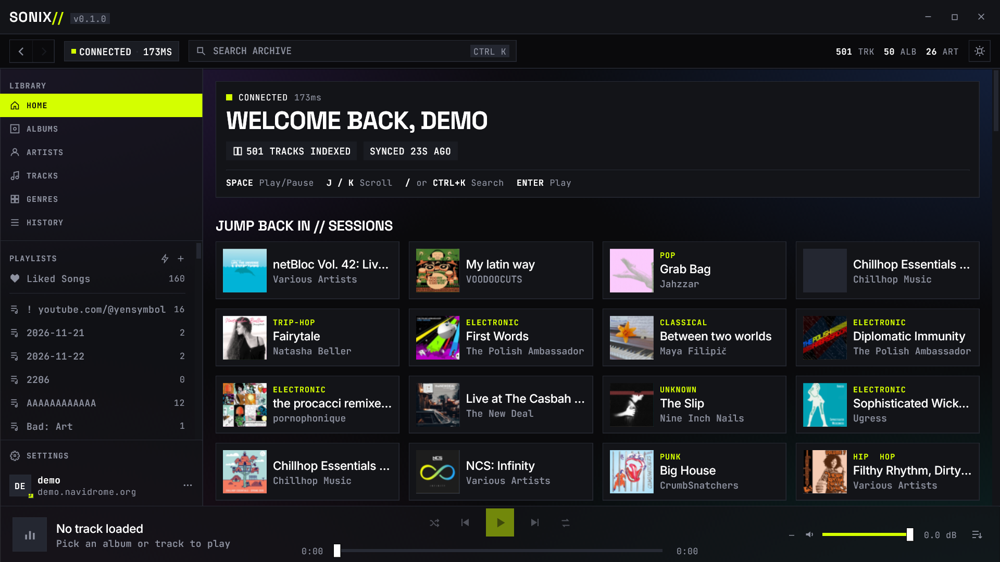
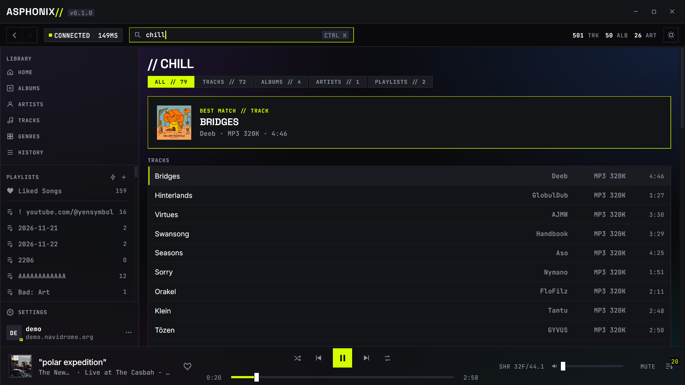

<div align="center">


# ASPHONIX//

### The player for audio enthusiasts.

A native desktop client for your **Navidrome / Subsonic** library.<br>
Bit-perfect on Windows · light on resources · open to AI agents.

[](https://github.com/aspherex/asphonix/actions/workflows/build.yml)
[](https://github.com/aspherex/asphonix/releases)
[](LICENSE)


[**TL;DR**](#-tldr) ·
[**Philosophy**](#-philosophy) ·
[**Features**](#-features) ·
[**Install**](#-install) ·
[**Agents (MCP)**](#-agentic-interaction-mcp) ·
[**Technology**](#-technology) ·
[**Shortcuts**](#-keyboard) ·
[**FAQ**](#-faq)

</div>

---

## // TL;DR

- **Bit-perfect on Windows.** WASAPI exclusive mode at the file's native sample rate, with a readout of the output mode that is really active.
- **Gapless**, with optional ReplayGain.
- **Native Rust + GPUI**, no browser engine. Budget targets: ≤ 40 MB RAM in normal use, ~300 ms to a visible window.
- **Instant browse and search** from a local index of your server library.
- **Now Playing** with waveform seek bar, spectrum, peak meters and synced lyrics.
- **Smart playlists and Flow**, a queue ordering by tempo, key and genre.
- **History, artist pages and a track-change preview** that appears while the app sits in the background.
- **Dark and light themes** with WCAG 2.2 AA text contrast; English and German UI.
- **MCP bridge for AI agents**, opt-in and local. No telemetry.

| | Compatibility at a glance |
|---|---|
| **Servers** | Navidrome 0.6x (tested) · other Subsonic API 1.16.1 / OpenSubsonic servers such as Gonic, LMS, Ampache, Airsonic-Advanced (should work, untested) · Jellyfin and Plex are not supported |
| **Windows** 10/11 x64 | Primary platform · WASAPI exclusive or shared · media keys (SMTC) |
| **macOS** (Apple Silicon), **Linux** (x64) | Newer, less tested · shared-mode output · no media-key integration yet |
| **Formats** | FLAC · ALAC · WAV · AIFF · MP3 · AAC / M4A · Ogg Vorbis |
| **Agents** | Claude Code or any MCP client over stdio |

---

ASPHONIX streams your library from a [Navidrome](https://www.navidrome.org/) (or any Subsonic / OpenSubsonic)
server and plays it through a native UI: a dark *audio terminal*, lime on near-black, with monospace readouts
where decoration would usually go. Every number on screen is either measured by the app or reported by your
server.

<picture>
  <source media="(prefers-color-scheme: light)" srcset="docs/screenshots/now-playing-light.png">
  
</picture>

<table>
  <tr>
    <td width="33%" valign="top">
      <h4>🎚️ Honest signal path</h4>
      In exclusive mode on Windows, at unity gain, the file reaches your DAC untouched. When the app has to
      fall back to shared mode, the header says so.
    </td>
    <td width="33%" valign="top">
      <h4>⚡ Native and lean</h4>
      A small Rust binary where every change is held to a memory and startup budget. Minimized, the target is
      a few MB and near-zero CPU.
    </td>
    <td width="33%" valign="top">
      <h4>🤖 Open to agents</h4>
      Ask an agent about your library and listening history and, if you allow it, let it run the queue.
    </td>
  </tr>
</table>

## // Philosophy

<p align="center"><b>Play the file as it is. Show what is true. Stay out of the way.</b></p>

ASPHONIX is built for people who care about *what actually reaches their ears*. Six principles decide what
goes in and what stays out.

<table>
  <tr>
    <td width="50%" valign="top">
      <h4><code>01</code> The signal path is sacred</h4>
      The original file is streamed from your server, decoded in Rust and, in exclusive mode, handed to your
      DAC at its native sample rate. No resampling, no hidden mixer, no "enhancement". Only volume and
      ReplayGain change samples, and only when you ask for them: at unity gain, playback is bit-perfect.
    </td>
    <td width="50%" valign="top">
      <h4><code>02</code> Honesty over decoration</h4>
      No fake meters, no invented quality badges. Sample rate, bit depth, format and output mode are shown as
      they are, including when exclusive mode is unavailable and the app falls back to shared mode. A number
      that can't be measured isn't shown.
    </td>
  </tr>
  <tr>
    <td width="50%" valign="top">
      <h4><code>03</code> A player, not a platform</h4>
      Your library belongs to your server. ASPHONIX keeps a fast local index of it, talks to nothing else
      unless you turn it on, and collects no telemetry.
    </td>
    <td width="50%" valign="top">
      <h4><code>04</code> Native or nothing</h4>
      No browser engine dressed up as an app. A small Rust binary with a memory and startup budget, animation
      at your display's refresh rate, and near-zero CPU while it waits in the background.
    </td>
  </tr>
  <tr>
    <td width="50%" valign="top">
      <h4><code>05</code> Keyboard first, mouse welcome</h4>
      Everything you do often has a key. Everything else is one click away.
    </td>
    <td width="50%" valign="top">
      <h4><code>06</code> Open to agents, on your terms</h4>
      Your library is data, and you should be able to ask it questions. ASPHONIX exposes it to AI agents over
      the Model Context Protocol, locally and off by default. Letting an agent control playback is a
      separate, explicit switch.
    </td>
  </tr>
</table>

## // Features

| | |
|---|---|
| **Playback** | Gapless · WASAPI exclusive or shared output · optional ReplayGain · A-B loop · ±10 s skips · session resume · optional play-queue sync with the server |
| **Library** | Home, Albums, Artists, Tracks, Genres · playlists and Liked Songs · ratings and stars · local smart playlists with a rule editor · full-text search on a local SQLite (FTS5) mirror of your server library |
| **Discovery** | **History**: your listening, day by day · artist pages with top tracks, biography and similar artists · genre browsing · "jump back in" sessions on Home |
| **Now Playing** | Waveform seek bar · 28-band FFT spectrum · peak meters · synced lyrics |
| **Queue** | Rolling queue window · drag-and-drop reordering · shuffle with artist spread · **Flow** ordering by tempo, key and genre (where your tags provide them) · autoplay / radio when the queue runs out |
| **Desktop** | **Track-change preview**: a small card in a screen corner of your choice when the track changes while ASPHONIX is in the background · Windows media controls and media keys · scrobbling to your server · light and dark theme · multiple server profiles |
| **Languages** | English and German, switchable at runtime (follows the OS language by default) |
| **Accessibility** | Text contrast meets WCAG 2.2 AA (4.5:1) for every text colour on every surface, in both the dark and the light theme, enforced by tests · visible keyboard focus on every control · keyboard shortcuts for all common actions ([status](docs/ACCESSIBILITY.md)) |
| **Agents** | MCP bridge with 17 read tools and 8 opt-in control tools ([details](#-agentic-interaction-mcp)) |

<table>
  <tr>
    <td width="50%"><a href="docs/screenshots/home.png"></a><p align="center"><sub><b>Home</b>: pick up a recent session where you left it</sub></p></td>
    <td width="50%"><a href="docs/screenshots/albums.png"></a><p align="center"><sub><b>Albums</b>: covers decoded at display size</sub></p></td>
  </tr>
  <tr>
    <td width="50%"><a href="docs/screenshots/tracks.png"></a><p align="center"><sub><b>Tracks</b>: format and bit depth for every file</sub></p></td>
    <td width="50%"><a href="docs/screenshots/search.png"></a><p align="center"><sub><b>Search</b>: the whole library, as you type</sub></p></td>
  </tr>
</table>

<p align="center"><sub>Screenshots use the public <a href="https://demo.navidrome.org">Navidrome demo</a> library;
its playlists are created by other demo visitors.</sub></p>

## // Install

Download the archive for your platform from [**Releases**](https://github.com/aspherex/asphonix/releases).
Builds are not code-signed yet, so the OS asks once:

| Platform | Steps |
|---|---|
| **Windows 10/11** | Unzip, run `asphonix.exe`. SmartScreen: *More info* → *Run anyway*. |
| **macOS** (Apple Silicon) | Open the `.dmg`, drag `ASPHONIX.app` to Applications. First start: right-click → *Open*, or `xattr -dr com.apple.quarantine /Applications/ASPHONIX.app`. |
| **Linux** (x64) | Unpack the `.tar.gz`, run `./asphonix`. A Secret Service provider (GNOME Keyring, KWallet) remembers your password. |

On first start, enter your server URL, user name and password. The password goes into the OS keychain, never
into a file. Settings, session and the library index live in the platform config/data directories
(`%APPDATA%\dev.asphonix.app` and `%LOCALAPPDATA%\dev.asphonix.app` on Windows).

### Platform support

| | Windows | macOS | Linux |
|---|---|---|---|
| Status | primary | newer, less tested | newer, less tested |
| Audio output | WASAPI exclusive (bit-perfect) or shared | shared (CoreAudio) | shared (ALSA) |
| Media keys / OS now-playing | ✓ (SMTC) | – | – |
| Password storage | Credential Manager | Keychain | Secret Service |

### Servers

**Tested:** Navidrome 0.6x. **Should work** (Subsonic API 1.16.1 / OpenSubsonic): Gonic, LMS, Ampache,
Airsonic-Advanced and others. Some features, such as synced lyrics, depend on what the server supports;
reports from other servers are welcome.

### Build from source

```sh
git clone https://github.com/aspherex/asphonix && cd asphonix
cargo run -p asphonix-ui --release        # builds target/release/asphonix(.exe) and asphonix-mcp
```

<details>
<summary>Toolchain and system packages</summary>

- A recent stable **Rust** toolchain (edition 2024).
- **Windows:** the MSVC build tools.
- **macOS:** Xcode (the full install: GPUI compiles its Metal shaders at build time).
- **Linux** (Debian/Ubuntu names): `pkg-config libasound2-dev libdbus-1-dev libfontconfig1-dev libfreetype6-dev
  libwayland-dev libxkbcommon-dev libxkbcommon-x11-dev libx11-xcb-dev libxcb1-dev libvulkan-dev libzstd-dev`

Development: `cargo test` and `cargo clippy --all-targets -- -D warnings`; see [CONTRIBUTING.md](CONTRIBUTING.md).

</details>

## // Agentic interaction (MCP)

Your library and your listening history are data. ASPHONIX lets an AI agent ask questions of them and, if you
permit it, act on the answers. It ships `asphonix-mcp`, a
[Model Context Protocol](https://modelcontextprotocol.io/) server that connects an agent to the running player.
Ask things like:

> *"What did I listen to most this month?"* · *"Which albums have I never played?"* ·
> *"Which tracks do I keep skipping?"* ·
> *"Build a 40-minute focus set from my liked ambient tracks and play it."*

| Access | Tools |
|---|---|
| **Read** (on when the bridge is enabled) | `search` `get_tracks` `get_album` `get_artist` `list_genres` `list_playlists` `get_playlist` `list_smart_playlists` `get_smart_playlist_tracks` `library_stats` `now_playing` `get_queue` `listening_history` `listen_events` `top_artists` `top_tracks` `skip_stats` |
| **Control** (separate opt-in) | `play_tracks` `play_source` `enqueue` `play_pause` `next` `previous` `seek` `set_volume_db` |

**Setup:** enable it in **Settings → Claude (MCP)**; the page shows the exact command to register it:

```sh
claude mcp add asphonix -- "C:\path\to\asphonix-mcp.exe"
```

**On your terms.** The bridge is off by default and only listens locally (a named pipe on Windows, a Unix
socket elsewhere). The app proves its identity to the client, and every session needs a fresh token. Reading
and controlling are two switches: an agent can look without being able to touch.

## // Technology

The signal path, from your server to your DAC:

```
SERVER    Subsonic stream             the original file, no transcoding
             │
DISK      temp file                   next track prefetched to disk, not RAM
             │
DECODE    Symphonia                   pure Rust
             │
BUFFER    rtrb ring buffer            small, lock-free
             │
OUTPUT    WASAPI exclusive / shared   Windows
          cpal                        macOS, Linux
```

Tracks hand off gaplessly. Waveform and spectrum (`realfft`) are computed in Rust from the decoded audio,
not drawn from canned animations.

| | |
|---|---|
| **Language** | Rust, edition 2024 |
| **UI** | [GPUI](https://www.gpui.rs/) 0.2.2 from crates.io, unpatched: Zed's GPU-rendered UI framework |
| **Architecture** | The UI reaches everything through one trait, `asphonix_api::Backend` |
| **Audio** | Symphonia decoding · `rtrb` ring buffer · `wasapi` on Windows, `cpal` on macOS and Linux |
| **Library** | SQLite (bundled, via `rusqlite`) with FTS5 full-text search, synced from the server · lists paged from SQLite and virtualized in the UI |
| **Network** | `reqwest` with `rustls` (no OpenSSL) on `tokio` · Subsonic API 1.16.1 token auth (salted MD5, per the Subsonic spec) · OpenSubsonic extensions such as synced lyrics via `getLyricsBySongId` |
| **Secrets** | OS keychain via the `keyring` crate |
| **OS integration** | Windows SMTC via the `windows` crate |
| **Updater** | Off unless configured · minisign signature verification (`minisign-verify`) |
| **MCP** | `asphonix-mcp`, a stdio MCP server that talks to the app over a local named pipe / Unix socket |

## // Keyboard

| Anywhere | | Now Playing | |
|---|---|---|---|
| <kbd>Space</kbd> | play / pause | <kbd>J</kbd> / <kbd>K</kbd> | −10 s / +10 s |
| <kbd>N</kbd> | open / close Now Playing | <kbd>Z</kbd> / <kbd>B</kbd> | previous / next track |
| <kbd>/</kbd> or <kbd>Ctrl</kbd>+<kbd>K</kbd> | search | <kbd>M</kbd> | mute |
| <kbd>L</kbd> | like the current track | <kbd>T</kbd> | lyrics |
| <kbd>J</kbd> / <kbd>K</kbd> | scroll the page | <kbd>Esc</kbd> | back to the library |
| <kbd>Enter</kbd> / <kbd>Shift</kbd>+<kbd>Enter</kbd> | play / enqueue the selection | | |
| <kbd>Alt</kbd>+<kbd>←</kbd> / <kbd>→</kbd> | back / forward | | |
| <kbd>Ctrl</kbd>+<kbd>T</kbd> | light / dark theme | | |

## // FAQ

<details>
<summary><b>The header says SHARED MODE. Why not exclusive?</b></summary>

Exclusive mode is Windows-only (Settings → Output). It needs a device that accepts the file's sample rate and
bit depth, and no other app holding that device exclusively. If the device refuses, ASPHONIX falls back to
shared mode and says so.
</details>

<details>
<summary><b>Does it work with Jellyfin or Plex?</b></summary>

No. ASPHONIX speaks the Subsonic / OpenSubsonic API only.
</details>

<details>
<summary><b>Does ASPHONIX phone home?</b></summary>

No. It talks to your server and nothing else. Scrobbling and update checks stay off unless you enable them,
and update checks also need a release channel to be configured ([docs/UPDATES.md](docs/UPDATES.md)).
</details>

<details>
<summary><b>Where are the logs?</b></summary>

Crashes are written to `logs/crash.log` in the data directory (`%LOCALAPPDATA%\dev.asphonix.app` on Windows).
For a detailed trace, start ASPHONIX with the environment variable `ASPHONIX_LOG=<file>`.
</details>

<details>
<summary><b>How accessible is it? Can I use a screen reader?</b></summary>

Text contrast meets WCAG 2.2 AA in both themes (checked by tests), every control shows a visible keyboard focus
ring, and common actions have shortcuts. Not yet: screen readers (the UI toolkit, GPUI, has no published
accessibility support, so screen readers see an unlabeled window), text zoom, and a reduce-motion setting.
The full assessment against WCAG 2.2 AA is in [docs/ACCESSIBILITY.md](docs/ACCESSIBILITY.md).
</details>

## // Contributing

Bug reports, server compatibility reports and pull requests are welcome. Please read
[CONTRIBUTING.md](CONTRIBUTING.md) and the [Code of Conduct](CODE_OF_CONDUCT.md). Security issues go through
[SECURITY.md](SECURITY.md), not public issues.

<details>
<summary>Repository layout</summary>

```
crates/asphonix-api    the Backend trait the UI talks to (types, commands, events)
crates/asphonix-core   Subsonic client, library DB + sync, audio engine, scrobbling, session, MCP bridge, updater
crates/asphonix-real   Backend implementation on top of asphonix-core (+ cover-art cache)
crates/asphonix-ui     the GPUI app, binary `asphonix`
crates/asphonix-mcp    MCP stdio server `asphonix-mcp` that connects to a running ASPHONIX
crates/asphonix-mcp-protocol  bridge wire format, handshake and tool catalog shared by asphonix-core and asphonix-mcp
crates/asphonix-logging  structured JSON-lines logging (subscriber, daily files, runtime verbosity) for both binaries
crates/asphonix-i18n   UI translations (Project Fluent, locales/en + locales/de) and locale-aware number/date formatting
crates/asphonix-testkit  dev-only: FakeBackend, MockSubsonic, fixtures (docs/TESTING.md)
docs/                  PERF (budgets and how to measure), GPUI-GAPS, UPDATES
```

</details>

## // License

MIT, see [LICENSE](LICENSE). The bundled fonts (Inter, JetBrains Mono, Space Grotesk) are under the SIL Open
Font License 1.1, see `assets/fonts/OFL-*.txt`.

Built on [GPUI](https://www.gpui.rs/) by Zed Industries, [Symphonia](https://github.com/pdeljanov/Symphonia),
[rusqlite](https://github.com/rusqlite/rusqlite) and the [OpenSubsonic](https://opensubsonic.netlify.app/) API.

---

<div align="center">
<sub><code>ASPHONIX//</code> &nbsp;The player for audio enthusiasts.</sub>
</div>
